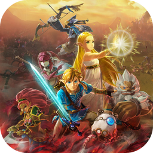

# AgeOfCalamityRecomp

### Hyrule Warriors: Age of Calamity, running natively on PC and Steam Deck

A static recompilation of the Nintendo Switch game: its ARM64 code is translated to C ahead of time and built into a
real PC program, with the graphics redone in Vulkan. 
No emulator, sharper resolutions, keyboard, mouse and modern controllers.

**[Download](https://github.com/eliasm4r/AgeOfCalamityRecomp/releases/latest)** ·
**[Install](#install)** ·
**[Steam Deck](#steam-deck)** ·
**[Controls](#controls)** ·
**[FAQ](#faq)** ·
**[Changelog](CHANGELOG.md)**

> [!IMPORTANT]
> **No game files are included.** You need your own copy of the game, dumped from your own Switch: the base game,
> **update 1.3.0** and, if you have them, the DLCs, plus your console's `prod.keys`. The setup builds the game from
> those files on your PC.
>
> **Only update 1.3.0 works** (v327680). Other updates are refused by the setup.

> [!NOTE]
> **Early access.** The game boots, plays its missions and battles, and saves, but expect rough edges. Please
> [report what you find](https://github.com/eliasm4r/AgeOfCalamityRecomp/issues).

 

## Highlights

- **Native code, no emulation**: about 101,000 functions of the game translated to C and compiled for x86-64.
- **Vulkan renderer**: NVN, the Switch's graphics API, reimplemented over Vulkan, with shaders translated once and kept
  for the next start.
- **Sharper picture**: 3D scene up to 150 % of a 1920x1080 output (supersampling) instead of the Switch's 1440x810,
  FSR 1 upscaling, NVIDIA DLSS / DLAA on RTX cards, anisotropic filtering, shadow quality, colour settings and HDR.
- **Steam Deck profile**: detected by itself, with full screen 1280x800, handheld render mode and a quick menu on
  **L3+R3**.
- **Keyboard and mouse** and **Xbox, PlayStation and Switch controllers**, every key and button rebindable (the
  controller plays as on the Switch, A on the right button, until you remap it), Xbox or PlayStation button prompts
  that change at once, rumble and motion.
- **All four DLCs** mounted from your own files, including *Pulse of the Ancients* and *Guardian of Remembrance*.
- **Options menu on F1** with graphics, sound, controls, amiibo, mods and cheats, and a **performance overlay on F10**.
- **Built-in problem reports**: one button makes a zip with the logs and your PC's details, nothing of the game.

The game runs at its own **30 fps** or at **60 fps** (Frame rate, in the quick menu or the full menu, applied at
once), at the right speed in both. **120, 144 and 240 fps are experimental**: still in development and not optimized
yet (above 60 the game steps by the real time of each frame, as in the TotK recomp; busy battles stay under 120).

 

## Install

1. Download **`AgeOfCalamityRecomp-<version>-Windows.zip`** (or **`-Linux.tar.gz`**) from the
   [latest release](https://github.com/eliasm4r/AgeOfCalamityRecomp/releases/latest) and extract it anywhere, for
   example in Downloads (on Linux, extract it where the game should live).
2. Start **`AgeOfCalamityRecomp Setup.exe`** (on Linux, `sh setup.sh`; it needs `python3-tk`, or `tk` on Arch and SteamOS).
3. In the setup window:
   - on Windows, choose where to install the game (about 25 GB; `%LOCALAPPDATA%\AgeOfCalamityRecomp` by default);
   - pick the folder holding your NSPs and `prod.keys` with **Browse...**. A check mark next to the base game,
     update 1.3.0 and `prod.keys` means they were found (DLC are optional). The files can have any name: the build
     identifies them by their contents;
   - tick **Windows (this PC)**, **Steam Deck / Linux**, or both;
   - press **Build** and let the PC work. The first time takes **20 to 30 minutes**; **Show details** shows the full log.
4. When it is done, press **Play**. Later, start the game from the **AgeOfCalamityRecomp** shortcut (Start Menu, and
   the desktop if you left the box ticked). Its settings are in the game itself: press **F1**, or Minus + Plus on a
   controller. The extracted zip can be deleted once the game is installed.

The setup downloads the free build tools it needs (about 2 GB: a compiler, and on Windows a private WSL Linux for
the Steam Deck version), extracts the game code from your files, translates it and compiles it.

> [!TIP]
> **Windows says it "protected your PC"?** The setup is not signed: click *More info*, then *Run anyway*.
> If Windows refuses it outright (Smart App Control), open the `python` folder and start **`Setup (if blocked).exe`**
> instead: it is the same setup, run by the signed official Python.
>
> **"WSL is not installed"?** Only the Steam Deck version needs it. Answer **Yes** when the setup offers to install it,
> accept the administrator prompt, restart the PC and press **Build** again: it continues where it stopped.

<b>Updating to a new version</b>

 

On Windows, extract the new zip anywhere, start its setup, keep the same install folder and press **Update**. On
Linux, extract the new package over the old folder and build again. Your `build` and `dist` folders stay, so only what
changed is redone, usually in minutes. Saves and settings (`dist/*/profile`, `dist/*/settings.ini`) are never overwritten.
With **RecompLauncher**, the game is built again by itself after an update.

<b>Where things go, and how to remove them</b>

 

| What | Where | Size |
|---|---|---|
| The setup, the extracted game data, the finished folders | the install folder (`build/`, `dist/`) | about 25 GB |
| Linux for Windows (Steam Deck version only) | WSL distro **AgeOfCalamityRecomp**, in `%LOCALAPPDATA%\AgeOfCalamityRecomp\wsl` | about 6 GB |
| The Windows compiler (Windows version only) | `C:\msys64` (MSYS2), if you did not have it | about 3 GB |
| Linux: build folder and Python packages | `~/AgeOfCalamityRecomp-build`, `~/.venvs/AgeOfCalamityRecomp` | about 6 GB |

To remove everything, delete the install folder; on Windows also run `wsl --unregister AgeOfCalamityRecomp` and delete
`C:\msys64` if the setup installed it; on Linux delete `~/AgeOfCalamityRecomp-build` and `~/.venvs/AgeOfCalamityRecomp`.

### Requirements

- **System**: Windows 10 (2004 or newer) or 11, or 64-bit Linux with `python3`
- **Memory**: 8 GB of RAM, 16 GB recommended
- **Graphics**: a Vulkan 1.3 graphics card (any recent NVIDIA, AMD or Intel)
- **Disk space**: about 45 GB during the first build, about 25 GB afterwards
- **Internet**: only for the first build, to download the tools
- **Game**: your own dump of the base game, update **1.3.0** and optionally the DLCs, with your `prod.keys`

 

## Steam Deck

The Deck does not compile anything: it receives the folder built on your PC.

1. The first time, tick **Include the game data** in the Platforms step so the game data (10.9 GiB) goes into the folder.
2. Copy the whole `dist/steamdeck` folder to the Deck (USB stick, SD card, network share or `scp`).
3. On the Deck, in **Desktop Mode**, open a terminal in that folder and run `sh install-shortcut.sh` once.
4. In Steam: *Games*, *Add a Non-Steam Game*, tick **Hyrule Warriors: Age of Calamity** and add it. It is now in your
   library in **Game Mode**.

Hold **L3+R3** for the quick menu (frame rate, console mode, overlay); **Minus + Plus** opens the full menu.

 

## Controls

Every key can be changed in the **Controls** tab of the options menu (**F1**). Keys follow their position, so `W A S D`
stays under your fingers on AZERTY. The table names the Switch buttons; the game's own button prompts tell what each
one does.

<table>
<tr><th>Switch button</th><th>Keyboard and mouse</th><th>Controller (Xbox pad)</th></tr>
<tr><td>Left stick</td><td><kbd>W</kbd> <kbd>A</kbd> <kbd>S</kbd> <kbd>D</kbd></td><td>Left stick</td></tr>
<tr><td>Right stick (camera)</td><td>Mouse, or arrows</td><td>Right stick</td></tr>
<tr><td>Y</td><td><kbd>Left click</kbd> or <kbd>L</kbd></td><td><kbd>X</kbd></td></tr>
<tr><td>X</td><td><kbd>Space</kbd> or <kbd>I</kbd></td><td><kbd>Y</kbd></td></tr>
<tr><td>A</td><td><kbd>E</kbd> or <kbd>K</kbd></td><td><kbd>B</kbd></td></tr>
<tr><td>B</td><td><kbd>Left Shift</kbd> or <kbd>J</kbd></td><td><kbd>A</kbd></td></tr>
<tr><td>ZL / ZR</td><td><kbd>Right click</kbd> or <kbd>Z</kbd> / <kbd>F</kbd> or <kbd>X</kbd></td><td><kbd>LT</kbd> / <kbd>RT</kbd></td></tr>
<tr><td>L / R</td><td><kbd>Q</kbd> / <kbd>R</kbd></td><td><kbd>LB</kbd> / <kbd>RB</kbd></td></tr>
<tr><td>Left / right stick press</td><td><kbd>Left Ctrl</kbd> / <kbd>C</kbd></td><td><kbd>L3</kbd> / <kbd>R3</kbd></td></tr>
<tr><td>D-pad</td><td><kbd>1</kbd> <kbd>2</kbd> <kbd>3</kbd> <kbd>4</kbd></td><td>D-pad</td></tr>
<tr><td>+ / -</td><td><kbd>Tab</kbd> / <kbd>M</kbd></td><td><kbd>Start</kbd> / <kbd>Back</kbd></td></tr>
</table>

| Key | Action |
|---|---|
| <kbd>F1</kbd> or <kbd>Esc</kbd> | Options menu |
| <kbd>F8</kbd> | Mark this moment in the logs (for a report) |
| <kbd>F10</kbd> | Performance overlay |
| <kbd>F11</kbd> | Full screen |

 

## FAQ

<b>Where do I get the game?</b>

 

From your own Switch and your own copy of the game. This project does not provide game files or keys and does not
help to find them.

<b>Why does the setup build the game instead of shipping it?</b>

 

The finished program is made from the game's code, which belongs to its owners and cannot be shared. So the package
ships only this project's own code and turns your files into the game on your PC. Do not share the folders it makes.

<b>Why no 120 or 144 fps on my 144 Hz screen?</b>

 

The game steps its world by whole 60 Hz vsyncs: two per frame at 30 fps (as on the Switch), one at 60 fps. So 30 and
60 are the rates it can run at the right speed. 60 fps needs about twice the processor time of 30.

<b>DLSS / DLAA is greyed out.</b>

 

It needs an NVIDIA RTX card and NVIDIA's `nvngx_dlss.dll` next to `AgeOfCalamityRecomp.exe`. The Windows build
downloads it from NVIDIA's DLSS SDK when it finds an RTX card. If that download failed (see the build log), build again
or put the file there yourself, then restart the game.

<b>The game crashed, froze or looks wrong. What do I send?</b>

 

In the setup window, press **Report a problem...**: it makes `AgeOfCalamityRecomp-report.zip` (logs and your PC's details, nothing of the
game, your user name replaced by `user`) and opens the [issue form](https://github.com/eliasm4r/AgeOfCalamityRecomp/issues).
Press <kbd>F8</kbd> when you see a glitch so the logs mark the moment. On a Steam Deck without the setup,
`./logs.sh bundle` makes the archive. Never attach game files, `prod.keys` or saves.

<b>The first battle stutters.</b>

 

Shaders are translated the first time they show up, then kept for the next sessions. An antivirus scanning every file
also slows the build and the first start: adding the install folder to its exclusions helps.

<b>Is it an emulator?</b>

 

No. An emulator reads the game's ARM64 instructions while you play. Here they are translated to C once, during the
build, and compiled into a normal program. Only the console underneath (its system services, graphics API, audio,
controllers and storage) is recreated.

 

## Building from source

See [`CONTRIBUTING.md`](CONTRIBUTING.md) for building by hand on WSL, Linux or MSYS2, and the project's rules.
How the port works and everything measured on the game is in [`docs/NOTES.md`](docs/NOTES.md).

 

## Credits

- Based on **[AoC Recomp](https://github.com/Azzulin/EXCUUUUSE-ME-PRINCESS-)** by Gabriel Azzulin and its
  contributors.
- Its runtime and lifter come from **[Astral Chain Recomp](https://github.com/captainj-sparrow/astral-chain-pc-recomp)**,
  **[TotK Recomp](https://github.com/valentderah/totk-pc-recomp)** and **[LAS Recomp](https://github.com/peiikai/LASRecomp)**;
  the game-specific knowledge comes from **[nxnative](https://github.com/seedds/nxnative)** and
  **[MacNativeGames](https://github.com/ly05010419/MacNativeGames)**; shaders are translated by
  **[Ryujinx](https://github.com/Ryubing)**'s translator.
- Third-party code and libraries are listed in [`THIRD_PARTY_NOTICES.md`](THIRD_PARTY_NOTICES.md).

## Legal

Independent fan project, not affiliated with or endorsed by Nintendo or Koei Tecmo. *Hyrule Warriors*, *The Legend of
Zelda* and *Nintendo Switch* are trademarks of their respective owners. You must supply your own legally obtained copy
of the game.

Licensed under the [GPL-3.0-or-later](LICENSE), with an added permission to use NVIDIA's DLSS library. Code
from other projects keeps its own licence, listed in [`THIRD_PARTY_NOTICES.md`](THIRD_PARTY_NOTICES.md).
